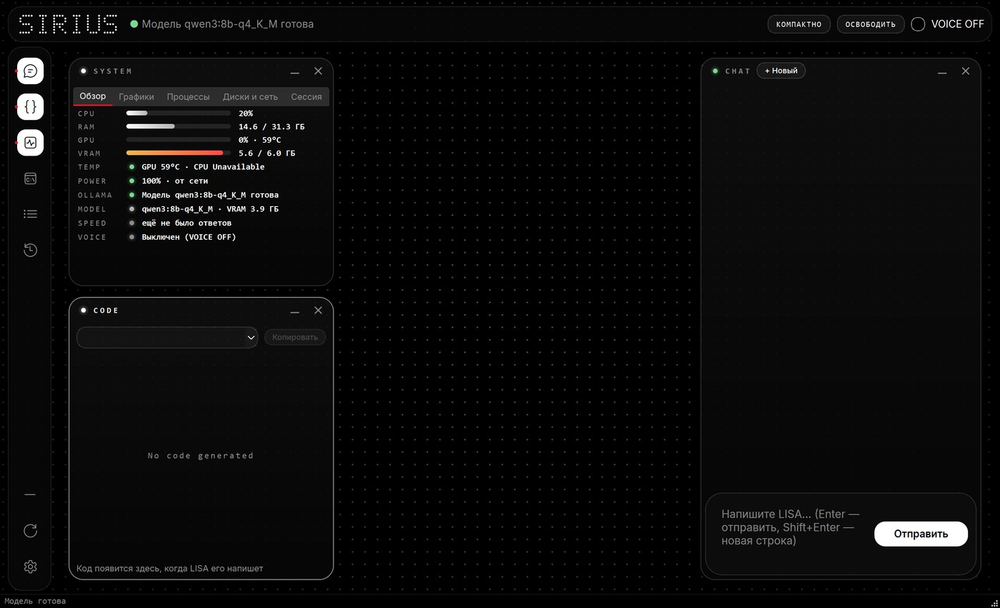
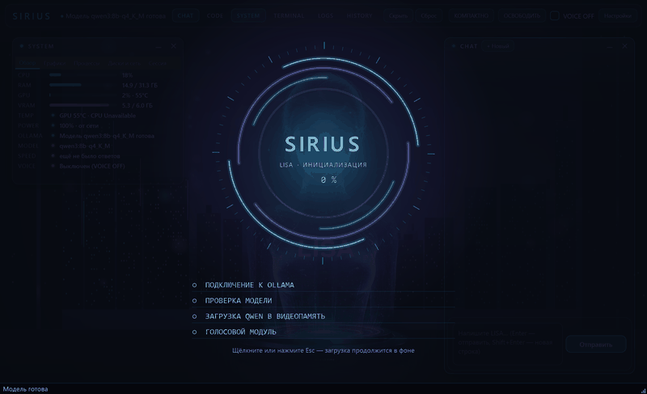
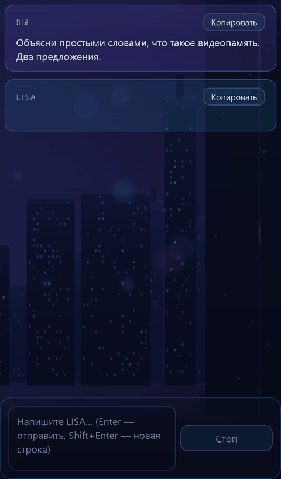
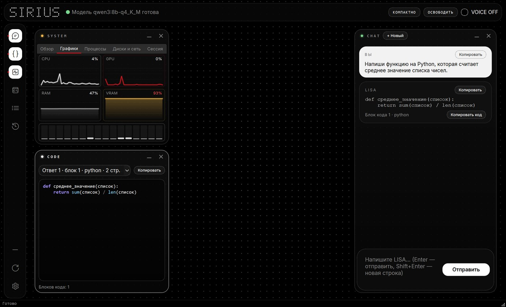
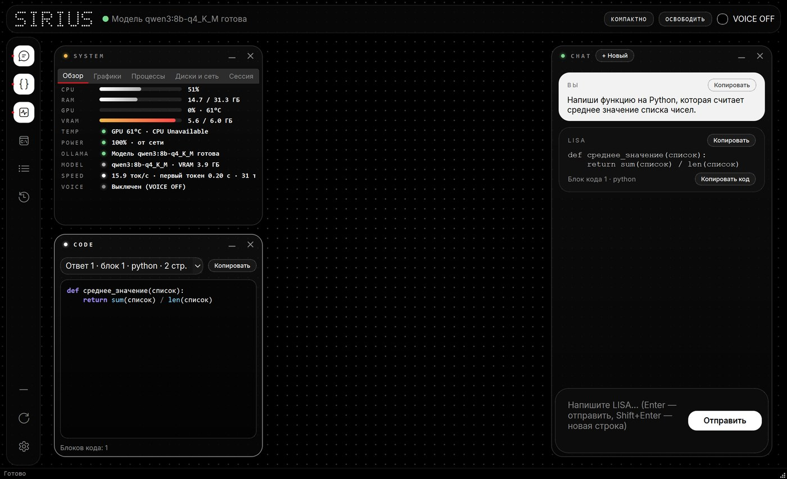
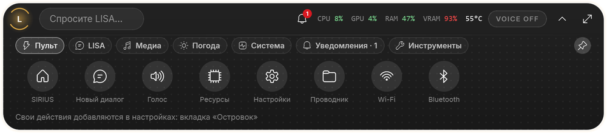
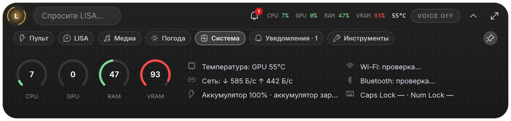
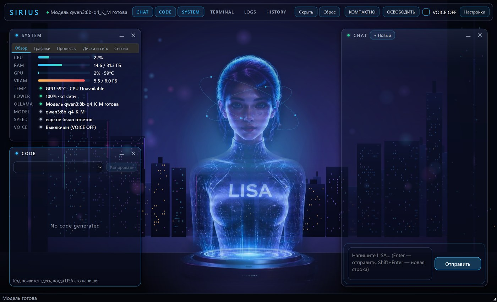
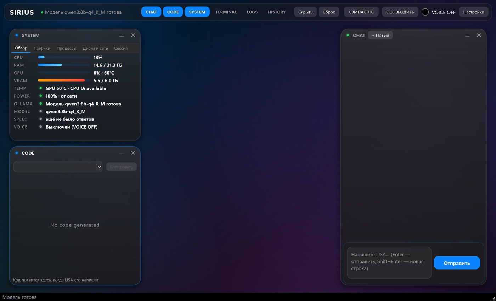

# SIRIUS v0.3 — LISA

Локальный интеллектуальный помощник для Windows с голографическим аватаром **LISA**.
Вы пишете в чат, локальная языковая модель отвечает, а LISA озвучивает ответ голосом.

**API-ключ не нужен.** Модель работает на вашем компьютере через Ollama. Интернет нужен только
для установки модели и голоса. Облачные сервисы не используются.

**Подходит любая локальная нейросеть из Ollama**: Qwen, Llama, Gemma, DeepSeek, Mistral и другие.
По умолчанию — Qwen 3 8B, но модель меняется одной строкой в настройках.



<p align="center">
  
  
</p>

| Графики мониторинга и CODE | Ответ с кодом |
|---|---|
|  |  |

### Островок

Капсула закреплена у верхнего края экрана, поверх других окон. В покое это мини-капсула с часами и погодой
(пока играет музыка — эквалайзер). Щелчок раскрывает её на вкладке «Пульт», переходы плавные.

<p align="center"></p>

| Пульт: быстрые действия | Система |
|---|---|
|  |  |

### Темы оформления

По умолчанию — монохромная тема **Nothing** (сверху). Ещё две: **SIRIUS — голография** с аватаром LISA
и **iPhone — тёмное стекло**. Переключение: «Настройки → Интерфейс → Тема», применяется после перезапуска.

| SIRIUS — голография | iPhone — тёмное стекло |
|---|---|
|  |  |

## Возможности

- **Рабочее пространство.** Плавающие панели CHAT, CODE, SYSTEM, TERMINAL, LOGS, HISTORY.
  Панели перетаскиваются, меняют размер, сворачиваются. Расположение сохраняется.
- **Чат.** Любая модель из Ollama, ответы появляются по мере генерации. Код из ответов собирается в панели CODE.
  История диалогов хранится в JSON.
- **Голос.** Silero (голос xenia) или запасной Piper. Громкость, скорость, высота и мягкость голоса.
  Щелчок по LISA или Esc останавливает речь.
- **Мониторинг.** Графики CPU, GPU, RAM и VRAM за 5 минут, загрузка ядер, температура GPU, диски,
  сеть, тяжёлые процессы (только просмотр), батарея, сводка за сессию.
- **Предупреждения** о перегреве, нехватке памяти, места на диске и заряда. Пороги задаются в настройках.
- **LISA знает состояние компьютера.** На вопрос «как там мой ПК?» она отвечает по реальным данным мониторинга.
- **Островок** (Ctrl+M) — капсула вместо окна:
  - **Пульт** — главная вкладка: SIRIUS, новый диалог, голос, ресурсы, настройки, проводник, Wi‑Fi, Bluetooth и свои действия;
  - **LISA** — вопрос прямо из капсулы, ответ раскрывается под строкой ввода;
  - **Медиа** — трек, обложка, управление плеером, общая громкость и визуализатор звука;
  - **Погода** — по городу, который вы укажете (сервис Open‑Meteo, без ключа; без города запросов нет);
  - **Система** — загрузка, температуры, сеть, аккумулятор, Wi‑Fi, Bluetooth, Caps Lock и Num Lock;
  - **Уведомления** — предупреждения SIRIUS и, по желанию, уведомления Windows;
  - **Инструменты** — полка файлов, история буфера обмена (пароли и ключи не сохраняются), Pomodoro;
  - индикаторы громкости, яркости и подключения питания.
- **Три темы оформления**, шрифт Inter, плавные переходы панелей.
- **Кнопка «Освободить»** выгружает модель и голос из памяти перед тяжёлой задачей (игра, рендер).
- **TERMINAL** — консоль только для ваших команд. Модель к ней доступа не имеет. Опасные команды требуют подтверждения.
- Значок в трее и автозапуск с Windows (по желанию, выключен по умолчанию).

Горячие клавиши: Ctrl+1…6 — панели, Ctrl+M — компактный режим, Ctrl+Shift+V — голос,
Ctrl+Shift+H — освободить или вернуть ресурсы, Ctrl+, — настройки, Esc — остановить речь.

## Системные требования

- Windows 10 или 11
- Python 3.11 или новее
- 16 ГБ оперативной памяти
- Видеокарта NVIDIA с 6 ГБ видеопамяти (желательно; без неё модель работает на процессоре, но медленнее)
- Около 8 ГБ свободного места

## Установка

### 1. Python

Установите Python 3.11+ с [python.org](https://www.python.org/downloads/). При установке отметьте **Add python.exe to PATH**.

### 2. Ollama и модель

1. Скачайте и установите Ollama: [ollama.com/download](https://ollama.com/download).
2. Загрузите модель (около 5,2 ГБ):

```bash
ollama pull qwen3:8b-q4_K_M
```

### 3. Проект

```bash
git clone https://github.com/grinxxx41-creator/Lisa.git
cd Lisa
python -m venv .venv
.venv\Scripts\activate
pip install torch --index-url https://download.pytorch.org/whl/cpu
pip install -r requirements.txt
```

Пакеты `winrt-*` из `requirements.txt` нужны только островку (музыка и уведомления Windows).
Если они не поставились, всё остальное работает.

### 4. Голос

Файлы голоса не входят в репозиторий: они большие. Положите их в папку `resources/voices/`.

**Основной голос — Silero xenia** (около 40 МБ, нужен `torch` из шага 3):

```bash
curl -L -o resources/voices/silero_v4_ru.pt https://models.silero.ai/models/tts/ru/v4_ru.pt
```

**Запасной голос — Piper irina** (около 60 МБ, нужны оба файла):

```bash
curl -L -o resources/voices/ru_RU-irina-medium.onnx https://huggingface.co/rhasspy/piper-voices/resolve/main/ru/ru_RU/irina/medium/ru_RU-irina-medium.onnx
curl -L -o resources/voices/ru_RU-irina-medium.onnx.json https://huggingface.co/rhasspy/piper-voices/resolve/main/ru/ru_RU/irina/medium/ru_RU-irina-medium.onnx.json
```

Достаточно одного голоса. Если файлов нет совсем, чат работает без озвучивания.

Включите голос кнопкой **VOICE** или в **«Настройки → Голос»**. Там же выбирается движок
(Silero или Piper), путь к модели Piper, громкость, скорость, высота и мягкость. Кнопка
«Тестовое воспроизведение» сразу проигрывает фразу.

Другой голос Piper: скачайте пару `.onnx` + `.onnx.json` из [piper-voices](https://huggingface.co/rhasspy/piper-voices/tree/main/ru/ru_RU)
и укажите путь к `.onnx` в настройках.

## Куда писать адрес модели (API)

SIRIUS обращается к локальному API Ollama. Ключ не нужен. Адрес задаётся в **«Настройки → AI»**
или в файле `storage/settings.json`, который создаётся при первом запуске:

```json
{
  "ollama_url": "http://127.0.0.1:11434",
  "model_name": "qwen3:8b-q4_K_M"
}
```

- **`ollama_url`** — адрес Ollama. Если Ollama запущена на другом компьютере в вашей сети, укажите его адрес,
  например `http://192.168.1.10:11434`. Используйте `127.0.0.1`, а не `localhost`: на Windows `localhost`
  отвечает на 2 секунды медленнее.
- **`model_name`** — имя модели в Ollama. Подойдёт любая модель из `ollama list`. На 6 ГБ видеопамяти лучше брать модели до 8B.

### Другая модель

```bash
ollama pull qwen3:32b
```

Затем укажите `qwen3:32b` в `model_name`. Большой модели нужно больше видеопамяти. Если её не хватает,
Ollama частично переносит модель на процессор, и ответы становятся медленнее. Проверено на Qwen 3 8B.

### Мощный сервер

Ollama можно запустить на другом, более мощном компьютере, а SIRIUS — на обычном ПК. На сервере
разрешите внешние подключения (переменная окружения `OLLAMA_HOST=0.0.0.0`) и укажите его адрес
в `ollama_url`, например `http://192.168.1.10:11434`. Модель будет считаться на сервере.

### Облачные нейросети через API

Пока не поддерживаются. В следующих версиях добавим работу через API (с ключом) —
для тех, кто хочет подключить облачную модель вместо локальной.

## Запуск

```bash
.venv\Scripts\activate
python main.py
```

Ярлык на рабочем столе (запуск без окна консоли):

```bash
.venv\Scripts\python.exe tools\create_shortcut.py
```

С ключом `--start-menu` ярлык появится и в меню «Пуск». При запуске SIRIUS показывает экран загрузки:
проверяет Ollama, загружает модель в видеопамять и готовит голос. При закрытии модель выгружается.

## Тесты

```bash
python -m pytest tests -q
```

Тесты с реальной моделью пропускаются, если Ollama не запущена.

## Хранение данных

| Что | Где |
|---|---|
| Настройки | `storage/settings.json` |
| История диалогов | `storage/chats/` |
| Журнал | `logs/sirius.log` |

Эти файлы создаются на вашем компьютере и не попадают в Git (`.gitignore`).

## Возможные ошибки

| Ситуация | Что делать |
|---|---|
| «Ollama не установлена» или «не запущена» | Установите Ollama и запустите её. SIRIUS пробует запустить установленную Ollama сам. |
| «Модель не загружена» | `ollama pull qwen3:8b-q4_K_M` или загрузка в окне настроек. |
| Голос не звучит | Проверьте файлы в `resources/voices/` и движок в «Настройки → Голос». Чат работает и без голоса. |
| SYSTEM показывает «Unavailable» для GPU | Нет видеокарты NVIDIA или `nvidia-smi`. Остальные данные работают. |
| Температура процессора недоступна | Windows не отдаёт её без прав администратора. Это ожидаемо. |
| Команда cmd не находится в TERMINAL | Встроенные команды cmd запускайте так: `cmd /c dir`. |

## Устройство проекта

| Папка | Что внутри |
|---|---|
| `core/` | Работа с моделью: запросы к Ollama, контекст диалога, политика команд консоли |
| `voice/` | Синтез речи Silero/Piper, подготовка текста к произношению, очередь воспроизведения |
| `monitoring/` | Сбор данных о системе, история, предупреждения, сводка для LISA |
| `storage/` | Настройки и история диалогов (JSON, безопасная запись) |
| `interface/` | Окно, аватар, панели, компактный режим, экран загрузки |
| `tests/` | Тесты pytest |

Подробнее: [PROJECT_ARCHITECTURE.md](PROJECT_ARCHITECTURE.md). Изменения по версиям: [CHANGELOG.md](CHANGELOG.md).

## Дорожная карта

- v0.4 — управление окнами и программами через Windows UI Automation
- v0.5 — многоэтапные задачи и система инструментов
- v0.6 — голосовая активация «Лиса»
